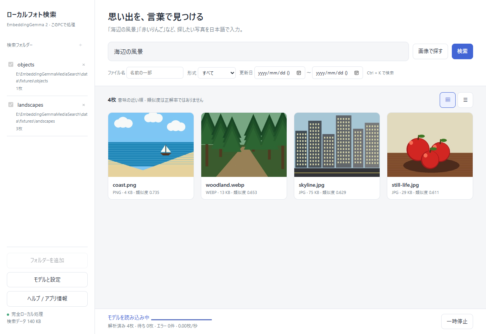

# Local Photo Search — ローカルフォト検索

Windows内の写真を日本語の説明や参照画像から探す無料の写真検索アプリです。EmbeddingGemma 2によるAI処理はPC内で行い、写真・検索語を外部へ送信しません。

## ダウンロード

**[GitHub Releases](https://github.com/VIDEdegi/local-photo-search/releases)** から `Local Photo Search_1.0.0_x64-setup.exe` を取得してください。「Source code」は開発者向けで、通常のインストーラーではありません。初回公開前はダウンロードできません。

1. セットアップを実行。未署名のためWindows/SmartScreenの警告が出る場合があります。公式配布元とSHA256SUMSを確認してください。
2. 初回案内でPCを診断し、既存の `.litertlm` モデルを指定するか、配布元・容量・条件を確認して公式モデルを取得。
3. 写真フォルダーを登録して「差分更新 / 解析」。
4. 「海辺の風景」などで日本語検索、または「画像で探す」で類似画像検索。

詳しくは [利用ガイド](docs/USER_GUIDE.md)。モデルは別途準備します。Python・Rust・Node.jsの導入は利用者に不要です。WebView2とMicrosoft Visual C++ v14 x64が不足する場合はMicrosoft公式の導入方法を案内します。

## 対応環境

- Windows 11 64bit。
- GPU確認済み：NVIDIA RTX 2070（8GB）。他GPUは未検証で、アプリ内診断が必要です。
- CPU：4スレッドの診断と少数人工画像で確認。大量写真の実用速度は未評価。
- Windows 10、ARM、32bitは初期サポート対象外。
- モデル約462MiB、AIキャッシュ最大1GiB、サムネイル最大512MiBと検索データ用の空き容量が必要。

クリーンWindows導入、スリープ・実OS再起動の受入確認は残っています。更新署名はWindowsコード署名とは別で、SmartScreen警告をなくすものではありません。

## 主な機能

- JPEG / PNG / WebP、サブフォルダー、追加・変更分の解析。
- 日本語・類似画像検索、名前・形式・更新日フィルター。
- グリッド/リスト、ページ表示、プレビュー・ズーム、元ファイル/保存場所を開く。
- 解析の停止・再開・エラー確認、初回設定、モデル管理、ライト/ダークテーマ。
- 許可した場合のトレイ常駐・バックグラウンド解析・Windowsログイン時の起動。
- 保存先の安全なコピー移行と容量・キャッシュ管理。

背景実行は既定OFF。許可すると×でトレイへ格納し、開始済みの解析が続きます。トレイの「完全終了」でWorkerも停止します。低負荷/アイドル設定により待機する場合があります。

## 更新・保存データ・プライバシー

起動時の更新確認は設定で無効化できます。設定から手動確認し、バージョン・変更内容を見て署名付き更新を実行できます。更新前に解析を安全に停止します。失敗した場合は完全終了し、Releasesのセットアップで手動更新してください。

更新・アンインストールで写真・モデル・検索データを削除しません。初期保存先は `%LOCALAPPDATA%/LocalPhotoSearch/data`、既存の保存先指定を優先します。再インストールでも既存データを利用できます。

外部通信は、確認後のモデル取得、GitHubへの更新確認/取得、必要なMicrosoft Runtime導入に使用します。写真・検索語を送信するクラウド検索やアプリ独自テレメトリーはありません。OS/WebView2の通信は各提供元の設定に従います。

## 報告・開発・ライセンス

[Issues](https://github.com/VIDEdegi/local-photo-search/issues) でバグ・提案を受け付けます。写真・個人用パスを投稿せず、ログは必要箇所を伏せ字にしてください。脆弱性は [非公開報告](SECURITY.md) を使ってください。

[CONTRIBUTING](CONTRIBUTING.md)、[行動指針](CODE_OF_CONDUCT.md)、[開発環境](docs/SETUP.md) を参照してください。Tauri 2 / Rust / Lit / TypeScript / SQLite / Python LiteRT-LMで構成しています。PRのCIは型・軽量安全性テスト・Rustチェックで、モデル/GPUは不要です。

独自コードは **Apache-2.0**。適用範囲は [LICENSE_SCOPE](LICENSE_SCOPE.md)、第三者の条件は [THIRD_PARTY_NOTICES](THIRD_PARTY_NOTICES.md) と `licenses/` を参照してください。AIモデルは別の条件で取得します。

写真検索を優先し、音声・動画は将来のアップデートです。[リリース運用](docs/RELEASE_PROCESS.md)、[v1.0.0リリースノート](docs/RELEASE_NOTES_V1.md) を参照してください。
